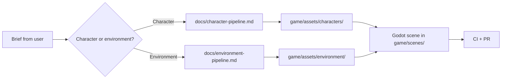

# AGENTS.md

Instructions for AI coding agents (Codex CLI, Claude Code, and similar) working in this repository.
Read this file first, then the pipeline guide for the task you were given.

## Project

| | |
| --- | --- |
| Game | **Xianxia 3D**: a third-person action-adventure about cultivation, sects, and sky-high mountains |
| Engine | **Godot 4.4+** (Forward+ renderer). The Godot project lives in [`game/`](game/project.godot) |
| Protagonist | A **female** cultivator. Working slug: `heroine` (final name is not decided, so keep it out of file names) |
| Theme | **Xianxia** (Chinese immortal-cultivation fantasy). See the art bible below |
| 3D generation | [Tripo CLI](https://www.npmjs.com/package/tripo-cli) (`tripo`) |
| 2D concepts | [Codex CLI](https://developers.openai.com/codex/cli) (`codex`) image generation, with `tripo generate text-to-image` as fallback |
| DCC | Blender 4.x, used for cleanup, sculpting, baking, and scene assembly |

## Which guide to follow

| Task | Guide |
| --- | --- |
| Create or change the **player character** (concept → model → rig → Godot) | [`docs/character-pipeline.md`](docs/character-pipeline.md) |
| Create or change **environments** (concept → assets → scene → Godot) | [`docs/environment-pipeline.md`](docs/environment-pipeline.md) |

Both guides are written as numbered stages. Do the stages in order and do not skip the checklist at the end of each one.



## Hard rules

1. **Credits cost money. Plan before you spend.** Every `tripo` command that generates or processes a model consumes credits. Always run the same command with `--dry-run --json` first. Only run it for real when the user has asked for generation, and report `credits_consumed` afterwards. Run `tripo balance` before any batch.
2. **Never commit secrets.** `TRIPO_API_KEY` and `~/.tripo` stay out of the repo. Do not paste keys into chat, logs, or docs. If `tripo` is not logged in, ask the user which region (`cn` or `ov`) they use, then run `tripo login --region <region>` and relay the URL and code to them.
3. **Inspect before you continue.** After each generation, open `preview.png` from the task output and judge it against the checklist in the guide. Re-roll with `tripo redo` or `-n 4` candidates before you process a bad result. Never pipe a bad mesh into rigging.
4. **Raw outputs are disposable, finals are not.** Write Tripo output to `art/tripo-out/<asset>/` (git-ignored). Commit only the final `.glb` in `game/assets/`, plus a provenance sidecar (see "Provenance").
5. **Stay on theme.** Every prompt must follow the art bible. No guns, modern clothing, sci-fi tech, or neon cyberpunk colours.
6. **The protagonist is female.** Every character prompt, concept sheet, and animation set must describe a young woman. Do not generate a male or ambiguous protagonist.
7. **One scale.** 1 Godot unit = 1 metre. The heroine is **1.65 m** tall. Props and architecture are sized against her.
8. **Do not hand-edit generated files.** Do not edit `.import` files, `.godot/`, or the contents of `art/tripo-out/`. Change import settings in the Godot editor or in the `.import` sidecar of the final asset.
9. **No merge conflicts, no red CI.** Rebase on `main` before you open a PR, run the local checks below, and do not mark work done while CI is failing.

## Art bible

**Mood:** serene, vast, mythic. Soft mist, bright sky, small human figures against huge landscapes.

| Element | Direction |
| --- | --- |
| Landscapes | Sheer karst peaks, floating islands, sea of clouds, waterfalls falling into mist, ancient pines, peach blossom, bamboo groves |
| Architecture | Multi-tier pagodas, curved upswept eaves, vermilion pillars, white stone terraces, carved balustrades, paifang gates, stone lanterns, hanging bridges |
| Interiors | Tea halls, alchemy pavilions, scripture libraries, cultivation caves, with paper screens, jade fixtures, incense burners, and bronze tripod cauldrons |
| Heroine | Young woman, slender, long black hair half-up with a jade hairpin, layered hanfu in white and celadon green with silver cloud embroidery, qi sash, jade pendant, cloth boots, a straight sword (jian) |
| Palette | Jade `#5FA38A`, celadon `#A8CDBB`, ivory `#F2EEE3`, ink `#1E2A33`, vermilion accent `#B8362E`, gold accent `#C9A24B`, sky `#8EB6C9` |
| Spirit energy | Soft cyan-jade glow (`#7FFFD4` emission). Use sparingly, only on talismans, swords, and qi effects |
| Style | Stylised realism with clean PBR materials and painterly textures. Not photoreal, not cartoon |

Use this phrase as the **style suffix** on every environment and prop prompt so assets look like one world:

```text
xianxia fantasy, ancient Chinese immortal cultivation world, stylized realistic, soft painterly PBR textures, jade and celadon palette, misty atmosphere
```

## Repository layout

```text
.
├── AGENTS.md                      # this file
├── README.md
├── docs/
│   ├── character-pipeline.md      # guide: heroine
│   ├── environment-pipeline.md    # guide: world
│   └── assets/reference/          # curriculum screenshots used by the guides
├── art/                           # source material, not shipped
│   ├── concepts/<asset>/          # 2D references (committed, PNG)
│   ├── manifests/*.yaml           # `tripo batch run` manifests (committed)
│   ├── blender/                   # .blend working files
│   └── tripo-out/                 # raw Tripo output (git-ignored)
├── game/                          # Godot project root (res://)
│   ├── project.godot
│   ├── scenes/
│   ├── scripts/
│   └── assets/
│       ├── characters/heroine/
│       └── environment/<zone>/
├── scripts/check_docs.py          # doc/link/command validator (runs in CI)
└── .github/workflows/ci.yml
```

## Naming

| Thing | Convention | Example |
| --- | --- | --- |
| Files and folders | `snake_case`, ASCII only | `jade_pagoda_01.glb` |
| Godot scenes | `snake_case.tscn` | `heroine.tscn` |
| GDScript classes | `PascalCase` class, `snake_case` members | `class_name Heroine` |
| Tripo history names (`--name`) | `kebab-case`, `<asset>-<stage>` | `heroine-lowpoly` |
| Animations | lower case, loop suffix `-loop` so Godot imports them as looping | `walk-loop`, `slash` |
| Collision meshes in Blender | node suffix `-colonly` | `pagoda_base-colonly` |

## Provenance

Next to every committed generated asset, store the Tripo task record so the asset can be reproduced:

```bash
cp art/tripo-out/<asset>/task.json game/assets/<group>/<asset>/<asset>.task.json
```

Never put the API key or an account id in these files. Check them before you commit.

## Tripo CLI cheat sheet

Run `tripo docs` for the full agent skill map shipped with the CLI. Everything below is verified against `tripo-cli` 0.7.x.

```bash
tripo doctor                       # key, region, network, balance
tripo balance                      # credits
tripo make "<prompt>" --for game-pc --dry-run --json --yes   # always plan first
tripo make "<prompt>" --for game-pc --json --yes -o art/tripo-out/<asset> --name <asset>-base
tripo make @<asset>-base --then decimate:20000 --json --yes   # continue from a named task
tripo redo @<asset>-base           # same request, new seed
tripo view @<asset>-base           # humans only; agents read preview.png
```

| Exit code | Meaning | What to do |
| --- | --- | --- |
| 0 | Success | Read the JSON on stdout |
| 2 | Bad parameters | Fix the command. The dry run reports why |
| 3 | Auth | `tripo doctor`, then `tripo login --region <cn\|ov>` |
| 4 | Out of credits | Stop and ask the user to run `tripo topup` |
| 5 | Content policy | Reword the prompt |
| 6 | Task failed or timed out | Credits are refunded on failure. On timeout use `tripo task watch <id>`; do not redo |
| 7 | Network | Check `tripo balance` before you retry, the submit may already exist |
| 8 | Not found | Check the task id or `@name` with `tripo history` |
| 9 | Rate limit | Retry with back-off |

Presets: `--for game-pc` (v3.1, detailed PBR) for hero props and the heroine, `--for game-mobile` (P1, clean low-poly) for bulk environment pieces, `--for anim` for anything that will be rigged.

Never invent `--param` keys. Look them up with `tripo docs --topic commands/generate` or `commands/process`.

## Codex CLI cheat sheet

```bash
codex exec -s workspace-write -C . "<task>"                 # non-interactive run in this repo
codex exec -s workspace-write -i art/concepts/heroine/concept.png "<task>"   # attach a reference image
```

Codex has the `image_generation` feature enabled. Use it for 2D references only: concept sheets, isometric master references, texture references. Always tell it the output path (`art/concepts/<asset>/<name>.png`) and verify the file exists afterwards. If the file is not written, fall back to `tripo generate text-to-image`.

## Godot rules

- Open and check the project with the Godot binary on `PATH` (`godot`):

  ```bash
  godot --headless --path game --import --quit
  godot --headless --path game --quit-after 2
  ```

- Import models as **glTF binary (`.glb`)**. Use FBX only when a Tripo option forces it (for example quad output).
- Humanoid rigs use `--spec mixamo` so bones match Godot's `SkeletonProfileHumanoid` bone map.
- Static environment meshes get **LODs** (Godot generates them on import) and `VisibilityRange` for far scenery.
- Repeated props (trees, rocks, lanterns, bamboo) go in a `MultiMeshInstance3D`, not hundreds of individual nodes.
- Keep the whole environment to **about 20 materials**. Share one material between pieces wherever the look allows it.
- Lighting: one `DirectionalLight3D` sun, a `WorldEnvironment` with fog for the mist sea, bake interiors with `LightmapGI`.

## Definition of done

An asset or change is done when all of these are true:

- [ ] It followed the guide stage by stage and met each stage checklist.
- [ ] The final `.glb` is in `game/assets/...` with its `.task.json` sidecar.
- [ ] The Godot project imports with no errors: `godot --headless --path game --import --quit`.
- [ ] The asset is placed in a scene under `game/scenes/` and looked at in the Godot editor.
- [ ] Scale checks out (heroine 1.65 m, doors about 2.2 m, steps about 0.18 m).
- [ ] `python3 scripts/check_docs.py` passes.
- [ ] The guide was updated if the workflow changed.

## Local checks

```bash
python3 scripts/check_docs.py                         # links, images, mermaid presence, tripo dry-runs
npx --yes markdownlint-cli2 "**/*.md" "#node_modules" # markdown style
godot --headless --path game --import --quit          # Godot project loads
```

`scripts/check_docs.py` runs `tripo make` as a **dry run** (no credits, no network, no key) for every line in the docs that starts with `tripo make "` and for every text job in `art/manifests/*.yaml`. When you add a Tripo example to a guide, write it as a self-contained `tripo make "<prompt>" ...` line so CI can check it.

## Git and PR conventions

- Branch from `main`, for example `feat/heroine-rig` or `docs/world-guide`.
- Small, focused commits with imperative subjects (`Add jade pagoda kit`).
- Rebase on `main` before you push. Do not leave merge commits or conflict markers.
- A PR must pass CI (`docs`, `mermaid`, `godot`) and show before/after screenshots when it changes what the game looks like.
- Never force-push a branch someone else is using.
