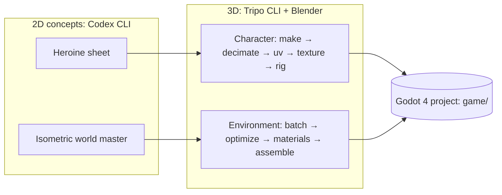
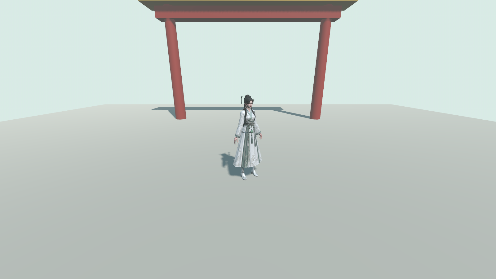
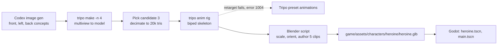

# 3dai

Learning to create 3D models and environments with AI and putting them in **Godot**. **Codex CLI** makes the 2D concepts and **Tripo CLI** makes the 3D assets.

The game is a **xianxia** (Chinese immortal-cultivation) action-adventure. The protagonist is a **female** sword cultivator.

[](https://github.com/jgyy/3dai/actions/workflows/ci.yml)

## Guides

| Guide | What you build |
| --- | --- |
| [Character pipeline](docs/character-pipeline.md) | The heroine: concept → 3D → sculpt → retopo → UV → bake → texture → rig → Godot (9 modules) |
| [Environment pipeline](docs/environment-pipeline.md) | The world: master reference → assets → optimize → materials → exterior → interior → Godot scene (7 lessons) |
| [AGENTS.md](AGENTS.md) | Rules and context for AI agents (Codex CLI, Claude Code) working in this repo |



## Run the game

The heroine is playable in a greybox test level. You need Godot 4.4 or newer on your `PATH` (`godot --version`).

```bash
# first run only: import the assets (creates game/.godot/, which is git-ignored)
godot --headless --path game --import --quit

# play
godot --path game

# or open the editor
godot --path game --editor
```

| Key | Action |
| --- | --- |
| `W` `A` `S` `D` or arrows | Move |
| `Shift` | Run |
| `Space` | Jump |
| `J` or left mouse | Slash |
| Mouse wheel up / down, or `E` / `Q` | Zoom camera in / out |

Save a screenshot from the real renderer (needs a display, so no `--headless`):

```bash
godot --path game --resolution 1600x900 --quit-after 600 -- --screenshot=docs/screenshots/heroine-idle.png
```



## How the heroine was made



Details, commands, and measured numbers are in the [character pipeline](docs/character-pipeline.md).

## Quick start

```bash
npm install -g tripo-cli
tripo login --region ov          # or --region cn
tripo doctor

# plan a generation without spending credits
tripo make "young female xianxia sword cultivator, white and celadon hanfu, A-pose" --for anim --dry-run --json --yes

# check the Godot project and the docs
godot --headless --path game --import --quit
python3 scripts/check_docs.py
```

## Repository layout

| Path | Contents |
| --- | --- |
| `docs/` | The two pipeline guides (text only, each stage opens with a curriculum summary) |
| `art/` | Concepts, batch manifests, and Blender files. Raw Tripo output (`art/tripo-out/`) is git-ignored |
| `game/` | The Godot 4 project (`res://`) |
| `scripts/check_docs.py` | Validates links, diagrams, and every Tripo command in the docs (dry run, no credits) |

## Requirements

Godot 4.4+, Blender 4.x or newer, Node.js 20+ (for `tripo-cli`), Codex CLI, Python 3.10+ with PyYAML (for the checks).

## Credits and licence

The stage structure of both guides follows a character and environment curriculum, and each stage opens with a short text summary of the matching course module. Code and docs are under the [Apache 2.0 licence](LICENSE).
