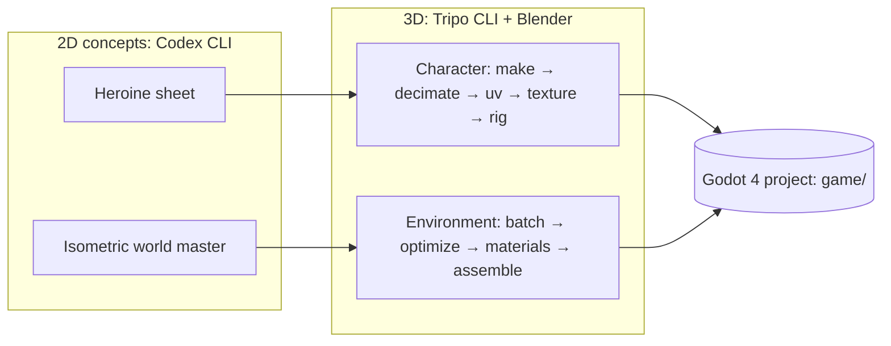

# 3dai

Learning to create 3D models and environments with AI and putting them in **Godot**. **Codex CLI** makes the 2D concepts and **Tripo CLI** makes the 3D assets.

The game is a **xianxia** (Chinese immortal-cultivation) action-adventure. The protagonist is a **female** sword cultivator.

[](https://github.com/jgyy/3dai/actions/workflows/ci.yml)

## Guides

| Guide | What you build |
| --- | --- |
| [Character pipeline](docs/character-pipeline.md) | The heroine: concept → 3D → sculpt → retopo → UV → bake → texture → rig → Godot (9 modules) |
| [Environment pipeline](docs/environment-pipeline.md) | The world: master reference → assets → optimize → materials → exterior → interior → Godot scene (7 lessons) |
| [AGENTS.md](AGENTS.md) | Rules and context for AI agents (Codex CLI, Claude Code) working in this repo |



## Quick start

```bash
npm install -g tripo-cli
tripo login --region ov          # or --region cn
tripo doctor

# plan a generation without spending credits
tripo make "young female xianxia sword cultivator, white and celadon hanfu, A-pose" --for anim --dry-run --json --yes

# check the Godot project and the docs
godot --headless --path game --import --quit
python3 scripts/check_docs.py
```

## Repository layout

| Path | Contents |
| --- | --- |
| `docs/` | The two pipeline guides and their reference screenshots |
| `art/` | Concepts, batch manifests, and Blender files. Raw Tripo output (`art/tripo-out/`) is git-ignored |
| `game/` | The Godot 4 project (`res://`) |
| `scripts/check_docs.py` | Validates links, diagrams, and every Tripo command in the docs (dry run, no credits) |

## Requirements

Godot 4.4+, Blender 4.x, Node.js 20+ (for `tripo-cli`), Codex CLI, Python 3.10+ with PyYAML (for the checks).

## Credits and licence

The stage structure of both guides follows a character and environment curriculum, whose course screenshots are included under `docs/assets/reference/` for study. Code and docs are under the [Apache 2.0 licence](LICENSE).
