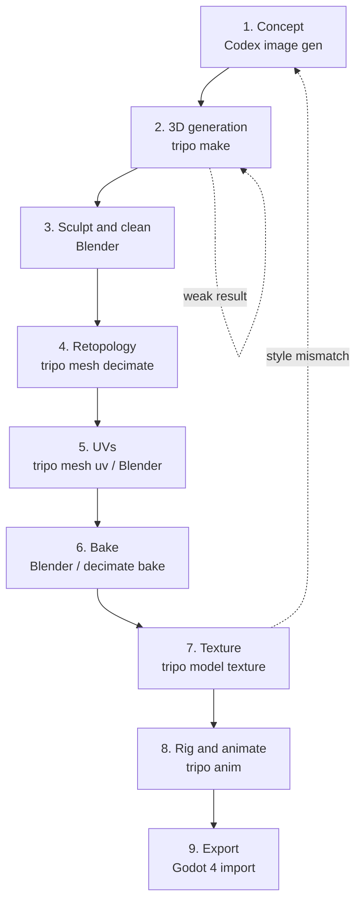

# Creating the heroine: 3D character pipeline

How to take the female xianxia protagonist from an idea to a rigged, animated, game-ready character in **Godot 4**, using **Codex CLI** for 2D references and **Tripo CLI** for 3D generation, with **Blender** for cleanup.

This guide adapts a nine-module character curriculum (each stage opens with a short summary of the matching module). The curriculum targets ChatGPT, Nano Banana, Tripo's web app, Modddif, Marmoset, Unity, and Unreal Engine 5. Here every step runs from the terminal, and the last stage targets Godot.

> AI agents: read [`AGENTS.md`](../AGENTS.md) first. Its hard rules (dry-run before spending credits, inspect every result, stay on theme, heroine is female) apply to every command below.

## Contents

- [Pipeline at a glance](#pipeline-at-a-glance)
- [Tool mapping](#tool-mapping)
- [Setup](#setup)
- [Character brief](#character-brief)
- [Module 1: Concept development](#module-1-concept-development)
- [Module 2: 3D model generation](#module-2-3d-model-generation)
- [Module 3: Sculpting](#module-3-sculpting)
- [Module 4: Retopology and optimization](#module-4-retopology-and-optimization)
- [Module 5: UV unwrapping](#module-5-uv-unwrapping)
- [Module 6: Texture baking](#module-6-texture-baking)
- [Module 7: Painting and texturing](#module-7-painting-and-texturing)
- [Module 8: Rigging and animation](#module-8-rigging-and-animation)
- [Module 9: Export to Godot](#module-9-export-to-godot)
- [Troubleshooting](#troubleshooting)

## Pipeline at a glance



Tripo can chain several stages in one command (`--then`). The guide keeps the stages separate so you can inspect and fix the result between them. Use the one-shot recipe at the end of [Module 8](#module-8-rigging-and-animation) only once the concept is proven.

## Tool mapping

| Curriculum tool | Used here | Why |
| --- | --- | --- |
| ChatGPT, Nano Banana Pro | `codex exec` with image generation, `tripo generate text-to-image` | Scriptable, stays in the repo |
| Tripo AI (web) | `tripo` CLI | Same engine, scriptable, `--dry-run` cost check |
| Blender | Blender 4.x | Sculpt, cleanup, baking, weight fixes |
| Modddif (retopo, UV) | `tripo mesh decimate`, `tripo mesh uv`, Blender | Fewer tools to install |
| Marmoset (baking) | Blender Cycles bake, or Tripo's built-in bake | Same result for a game character |
| Unity, Unreal Engine 5 | **Godot 4.4+** | The game engine of this project |

## Setup

```bash
npm install -g tripo-cli          # Tripo CLI (tripo --version → 0.7.x)
tripo login --region ov           # or --region cn. Opens a browser approval, no key is pasted
tripo doctor                      # verifies key, region, network, balance
codex --version                   # Codex CLI
godot --version                   # Godot 4.4 or newer
blender --version                 # Blender 4.x
```

Create the working folders once:

```bash
mkdir -p art/concepts/heroine art/tripo-out/heroine art/blender game/assets/characters/heroine
```

## Character brief

Keep this brief open while you work. Every prompt below is derived from it.

| Field | Value |
| --- | --- |
| Role | Young female sword cultivator, the player character |
| Height | 1.65 m, slender, athletic |
| Hair | Long black hair, half-up, jade hairpin |
| Outfit | Layered hanfu: white inner robe, celadon-green outer robe with long flowing sleeves, silver cloud embroidery, qi sash, jade pendant, cloth boots |
| Gear | A straight sword (jian) on the back or hip |
| Pose for generation | **A-pose or T-pose**, arms away from the body, neutral expression, feet shoulder-width |
| Palette | Ivory `#F2EEE3`, celadon `#A8CDBB`, jade `#5FA38A`, ink `#1E2A33`, silver and gold accents |

---

## Module 1: Concept development

> **Curriculum summary.** Create strong 2D references for the whole character pipeline: generate the core idea, refine it into a clean production-ready concept, split the character into parts, and prepare extra views for accurate 3D generation. This stage saves time on every step that follows.

**Goal:** a complete set of clean 2D references ready for 3D generation.
**Tools:** Codex CLI (image generation), `tripo generate text-to-image`.

### Why it matters

Every later stage inherits the concept. A concept with clear shapes, one outfit, and views from several angles saves credits and rework in every stage that follows.

### Steps

1. **Generate the core idea.** Ask Codex for a front-view concept of the brief. Tell it where to save the file.

   ```bash
   codex exec -s workspace-write \
     "Generate a full-body concept image of a young female xianxia sword cultivator: slender, 1.65 m, \
   long black hair half-up with a jade hairpin, layered white and celadon-green hanfu with long flowing \
   sleeves and silver cloud embroidery, qi sash, jade pendant, cloth boots, straight sword on her back. \
   A-pose, neutral expression, plain light-grey background, flat even lighting, front view. \
   Save it as art/concepts/heroine/front.png and confirm the file exists."
   ```

2. **Refine to a production-ready concept.** Attach the first result and fix problems one at a time (sleeve length, hairpin shape, sword position). Change one thing per request so you can tell what helped.

   ```bash
   codex exec -s workspace-write -i art/concepts/heroine/front.png \
     "Same character. Make the outer robe sleeves shorter so the hands are visible, keep everything else \
   identical. Save as art/concepts/heroine/front_v2.png."
   ```

3. **Prepare the views Tripo needs.** Generate **back**, **side**, and **three-quarter** views of the same character by attaching `front_v2.png` each time. Save them as `back.png`, `side.png`, and `three_quarter.png`.
4. **Split into parts.** Generate one sheet with the separated parts: hair, outer robe, inner robe, sash, sword and scabbard, boots, jewellery. Save it as `parts.png`. You will use it to check Module 3 and for texture references in Module 7.
5. **Fallback without Codex.** If image generation is unavailable, Tripo can produce a T-pose reference directly:

   ```bash
   tripo generate text-to-image "full-body front view of a young female xianxia cultivator, white and celadon hanfu, jade hairpin" \
     -p template=t_pose --json --yes -o art/tripo-out/heroine --name heroine-concept
   ```

### Reference quality checklist

- [ ] One character, full body, nothing cropped.
- [ ] Plain background, even lighting, no cast shadows.
- [ ] A-pose or T-pose, arms clear of the torso, hands visible.
- [ ] Face is neutral. Avoid hair strands or fabric hiding the hands.
- [ ] Same outfit, colours, and proportions in every view.
- [ ] Clearly **female** and **xianxia** (no modern clothing or armour).

### Batching trick

Ask for several views on **one** sheet (front, side, back, three-quarter) in a single request, then crop them. It uses one generation instead of four.

**You walk away with:** `art/concepts/heroine/` holding `front_v2.png`, `back.png`, `side.png`, `three_quarter.png`, `parts.png`.

---

## Module 2: 3D model generation

> **Curriculum summary.** Turn the 2D references into initial 3D meshes with AI generation tools: choose the right generator, evaluate results, regenerate weak outputs, and bring the selected meshes into Blender. The goal is a usable base model and separated generated parts, ready for cleanup and sculpting.

**Goal:** a raw 3D base model, plus generated parts, ready for refinement.
**Tools:** `tripo make`, Blender.

### Steps

1. **Validate the plan first. This costs nothing:**

   ```bash
   tripo make "young female xianxia sword cultivator, slender, long black hair half-up with jade hairpin, layered white and celadon-green hanfu with flowing sleeves, silver cloud embroidery, qi sash, jade pendant, cloth boots, A-pose, neutral expression" --for game-pc -n 4 --name heroine-base --dry-run --json --yes
   ```

2. **Generate from the concept images.** Image input follows the concept more closely than text. Four views give the best likeness:

   ```bash
   tripo make art/concepts/heroine/front_v2.png art/concepts/heroine/back.png art/concepts/heroine/side.png \
     --for game-pc -n 4 --name heroine-base -o art/tripo-out/heroine --json --yes
   ```

   `-n 4` creates four candidates in parallel so you can pick the best.
3. **Evaluate.** Open each `preview.png`. Pick the candidate with the best silhouette and the cleanest hands, face, and hair. If none is usable, regenerate with a fresh seed:

   ```bash
   tripo redo @heroine-base
   ```

4. **Text-only variant.** If you have no usable images, generate from the prompt in step 1 without `--dry-run`. Accept a rougher likeness.
5. **Generate separate parts** when the generator merges hair, sword, and robe into one lump. Either segment the finished model:

   ```bash
   tripo mesh segment @heroine-base --json --yes
   ```

   or ask for parts at generation time. The CLI turns texture and PBR **off** for part generation, so re-texture afterwards in [Module 7](#module-7-painting-and-texturing):

   ```bash
   tripo make "young female xianxia sword cultivator, layered white and celadon-green hanfu, jade hairpin, A-pose, neutral expression" --for game-pc -p generate_parts=true --name heroine-parts --dry-run --json --yes
   ```

6. **Bring the model into Blender.** `File → Import → glTF 2.0` for the `.glb` in `art/tripo-out/heroine/`. Save as `art/blender/heroine.blend`.

### Choosing a generator

| Situation | Choice |
| --- | --- |
| Hero asset, rich detail and PBR | `--for game-pc` (v3.1) |
| Cleaner topology from the start, lower budget | `--for game-mobile` (P1), or add `-p smart_low_poly=true` on v3.x |
| The character will be rigged | `--for anim`, which gates the chain with a rig check |

### Checklist

- [ ] Four candidates reviewed through `preview.png`, not just the first one.
- [ ] Face, hands, and sleeves are readable.
- [ ] The model is a single character, facing +Z or -Y consistently.
- [ ] The Blender file is saved and the `.glb` is untouched in `art/tripo-out/`.

**You walk away with:** a raw 3D base model (and optional separated parts) imported in Blender.

---

## Module 3: Sculpting

> **Curriculum summary.** Clean up the generated geometry and reshape the character into a stronger final form: correct major artefacts, improve silhouette and anatomy, align the model into a proper pose, and prepare separate parts for assembly. This is where the AI result starts becoming an intentional character instead of just a generated mesh.

**Goal:** a cleaned, sculpted high-poly character with an improved silhouette and anatomy.
**Tools:** Blender.

AI geometry comes out with artefacts. This is the stage where it becomes an intentional character.

### Steps

1. **Duplicate first.** Keep the raw import hidden in a collection named `RAW`. Work on a copy in `HIGH`.
2. **Fix major artefacts.** In Sculpt Mode use **Smooth**, **Clay Strips**, and **Grab** to remove spikes, fused fingers, and holes in sleeves.
3. **Improve silhouette and anatomy.** Check the outline against `front_v2.png` with the concept as a background reference (`Add → Image → Reference`). Correct shoulders, waist, and leg proportions. The silhouette must read at a distance.
4. **Pose.** Align to a clean A-pose: arms about 45° from the body, legs shoulder-width, head level, with the character facing the front axis.
5. **Separate parts** for assembly: hair, robe layers, sash, sword and scabbard, boots, jewellery. `Edit Mode → P → By loose parts`, then name each object (`hair`, `robe_outer`, `sword`).
6. **Set scale and origin.** Scale the full body to **1.65 m** and put the origin at the floor between the feet. `Object → Apply → All Transforms`.

### Checklist

- [ ] Silhouette matches the concept in front and side views.
- [ ] No holes, floating fragments, or non-manifold edges in the body.
- [ ] Hands have five readable fingers (or clean mitten shapes).
- [ ] Parts are separate objects with clear names.
- [ ] Height is 1.65 m, transforms are applied.

**You walk away with:** a cleaned and sculpted high-poly character in `art/blender/heroine.blend`.

---

## Module 4: Retopology and optimization

> **Curriculum summary.** Convert the sculpted high-poly result into a cleaner, lighter low-poly mesh suitable for games and animation: use AI-assisted retopology, optimise mesh density, align low and high versions, and manually fix important topology issues. Pay special attention to silhouette preservation, deformation areas, and production-friendly geometry.

**Goal:** a light low-poly mesh that matches the sculpt and is ready for UVs, baking, texturing, and rigging.
**Tools:** `tripo mesh decimate`, Blender.

### Steps

1. **Export the sculpt from Blender** as `art/tripo-out/heroine/heroine_high.glb` (`File → Export → glTF 2.0`, **Apply Modifiers** on).
2. **Plan the decimation:**

   ```bash
   tripo make art/tripo-out/heroine/heroine_high.glb --then decimate:20000 --name heroine-lowpoly --dry-run --json --yes
   ```

3. **Run it for real.** This uses Tripo's smart retopology and bakes the high-poly textures onto the low-poly by default:

   ```bash
   tripo make art/tripo-out/heroine/heroine_high.glb --then decimate:20000 --name heroine-lowpoly \
     -o art/tripo-out/heroine --json --yes
   ```

4. **Direct command when you already have a task.**

   ```bash
   tripo mesh decimate @heroine-base --face-limit 20000 --name heroine-lowpoly
   ```

5. **Manually fix important topology in Blender.** Check edge loops at the **shoulders, elbows, knees, hips, and the neck**, because these areas deform. Add loops where the bend collapses.

### Budget

| Part | Triangles |
| --- | --- |
| Whole heroine (LOD0) | ≤ 20,000 |
| Head and hair | ~6,000 |
| Body and robes | ~11,000 |
| Sword and accessories | ~3,000 |

Tripo's decimate accepts **500–20,000 triangles** (10,000 for quad). `--quad` output cannot be exported as glTF, so use quads only if you plan to finish in Blender and export again.

### Checklist

- [ ] Silhouette is preserved: overlay the low-poly on the high-poly in Blender.
- [ ] Triangle count is within budget (`Overlays → Statistics`).
- [ ] Loops exist at every joint.
- [ ] No overlapping or flipped faces.

**You walk away with:** an optimized low-poly mesh that matches the sculpt.

---

## Module 5: UV unwrapping

> **Curriculum summary.** Prepare the low-poly model for texturing by creating clean UVs: know when automatic unwrapping works, how to detect mistakes, and how to fix seams, islands, and material organisation in Blender. This module makes the model technically ready for baking and texture painting.

**Goal:** clean UVs and organised materials, so the model is technically ready for baking and painting.
**Tools:** Blender, `tripo mesh uv`.

### Steps

1. **Try the automatic unwrap.** It re-unwraps and remaps the existing textures, rig, and animation (input must be ≤ 80,000 triangles, which Module 4 guarantees):

   ```bash
   tripo mesh uv @heroine-lowpoly --name heroine-uv -o art/tripo-out/heroine
   ```

2. **Detect mistakes in Blender.** In the UV Editor, assign a **checker texture** (`UV Grid`) and look for stretching, mismatched square sizes, and seams across the face.
3. **Fix manually.** Mark seams where they hide: under the hair line, along the inside of sleeves, under the sash, and along the back centre. `Edit Mode → U → Unwrap`, then **Pack Islands** with a margin of at least 4 px at 2048.
4. **Organise materials.** One material per surface family, not per object:

   | Material | Covers |
   | --- | --- |
   | `heroine_skin` | Face, hands, neck |
   | `heroine_hair` | Hair and hairpin |
   | `heroine_cloth` | Inner and outer robe, sash, boots |
   | `heroine_metal_jade` | Sword, pendant, ornaments |

### Checklist

- [ ] No overlapping islands (unless mirrored on purpose).
- [ ] Face has the most texel density.
- [ ] Seams are hidden.
- [ ] Four materials or fewer.

**You walk away with:** a properly unwrapped model with usable UVs and organised materials.

---

## Module 6: Texture baking

> **Curriculum summary.** Transfer high-poly detail onto the optimised low-poly mesh: learn the logic of baking, how normal maps and other texture maps are generated, and how to use both automated and manual baking workflows for production-ready results.

**Goal:** a baked low-poly model with the essential texture maps, ready for texturing.
**Tools:** Blender, Tripo's built-in bake.

### Two ways to bake

| Workflow | When | How |
| --- | --- | --- |
| Automated | Quick, good enough for most characters | `tripo mesh decimate` already baked textures from the high-poly onto the low-poly. Check them in Blender |
| Manual | You sculpted fine detail (embroidery, wrinkles) that must survive | Blender Cycles bake |

### Manual bake in Blender

1. Put the high-poly (`HIGH`) and low-poly (`LOW`) at the same origin.
2. Select `HIGH`, then shift-select `LOW` (active).
3. Render engine **Cycles** → **Bake**: *Selected to Active*, **Cage** on, extrusion about 0.02 m.
4. Bake these maps at **2048 × 2048** (4096 for the head only if needed):
   - **Normal** (Tangent space)
   - **Ambient Occlusion**
   - **Curvature** (via Geometry Pointiness, optional)
5. Save images into `art/blender/heroine_textures/`.

### Checklist

- [ ] Normal map shows no skewed or inverted details.
- [ ] No ray-miss artefacts (dark or white splotches) at the arms and under the robe.
- [ ] Maps are named `heroine_<material>_<map>.png`.

**You walk away with:** a baked low-poly model with essential maps.

---

## Module 7: Painting and texturing

> **Curriculum summary.** Build the final surface look of the character with AI-assisted and manual texturing: create and refine base colour, adjust materials, paint corrections by hand, and build core PBR maps including roughness, metallic, and emission. This is where the model gets its final visual identity.

**Goal:** the final surface look, with production-ready PBR maps.
**Tools:** `tripo model texture`, Blender, Codex CLI for references.

### Steps

1. **Texture with AI.** Re-texture the baked low-poly. Use `detailed` for the hero:

   ```bash
   tripo model texture @heroine-uv --texture-quality detailed --texture-alignment original_image \
     --name heroine-textured -o art/tripo-out/heroine --json --yes
   ```

   `original_image` follows the concept art closely. Use `geometry` if the texture drifts from the shape.
2. **Correct the base colour against the concept.** AI textures drift in colour. Compare with `front_v2.png` and the palette in [`AGENTS.md`](../AGENTS.md). Fix cloth colours, skin tone, and hair in Blender Texture Paint, using the saved `parts.png` as reference.
3. **Paint corrections by hand:** hairline, eyes, hand edges, embroidery on the sleeves, sash knots.
4. **Build the PBR maps.**

   | Map | Heroine guidance |
   | --- | --- |
   | Base Color | No baked lighting. Even, soft, painterly |
   | Roughness | Silk ≈ 0.45, cotton ≈ 0.8, skin ≈ 0.55, jade ≈ 0.25, metal ≈ 0.3 |
   | Metallic | 0 everywhere except the sword (≈ 1.0) and metal trim |
   | Normal | From the Module 6 bake, kept at low strength on cloth |
   | Emission | Jade-cyan `#7FFFD4` only on the pendant and sword talisman |

### Checklist

- [ ] Palette matches the concept and the art bible.
- [ ] No baked shadows in Base Color.
- [ ] Emission is limited to the pendant and sword.
- [ ] Viewed under a neutral HDRI in Blender, the materials look right.

**You walk away with:** a fully textured character with PBR materials.

---

## Module 8: Rigging and animation

> **Curriculum summary.** Prepare the character for movement by building or importing a skeleton and fixing deformation weights: learn the basics of rigging, compare auto-rig solutions, and correct the most important weight-painting areas for clean animation. A simple animation pass tests the character in motion.

**Goal:** a rigged character with clean deformation and a test animation set.
**Tools:** `tripo anim`, Blender (weight fixes), Godot (retargeting).

### Steps

1. **Check riggability first.** It is cheap and catches problems before you spend rig credits. The input must be a GLB:

   ```bash
   tripo anim check @heroine-textured --json
   ```

2. **Rig.** The Mixamo spec gives humanoid bone names that Godot maps with `SkeletonProfileHumanoid`:

   ```bash
   tripo anim rig @heroine-textured --rig-type biped --spec mixamo --out-format glb \
     --name heroine-rigged -o art/tripo-out/heroine --json --yes
   ```

3. **Apply preset animations** (up to 5 per call, billed per animation). Use `--animate-in-place` so Godot's `CharacterBody3D` moves the character:

   ```bash
   tripo anim retarget @heroine-rigged \
     --animation preset:idle preset:walk preset:run preset:jump preset:slash \
     --animate-in-place --name heroine-animated -o art/tripo-out/heroine --json --yes
   ```

   Other presets: `preset:hurt`, `preset:fall`, `preset:turn`, `preset:climb`, `preset:shoot`, `preset:dive`.
4. **Check deformation in Blender.** Import the GLB, scrub through each animation, and look at these weight-paint trouble spots:
   - **Shoulders and armpits** (sleeves collapsing)
   - **Hips and robe skirt** (legs poking through the cloth)
   - **Elbows and knees**
   - **Neck and hair** (hair should follow the head, not stretch)
5. **Fix weights** in Weight Paint mode: *Smooth* for pinching, *Average* for stray weights, then re-export.

### Compare auto-rig options

| Option | Pros | Cons |
| --- | --- | --- |
| `tripo anim rig` (this guide) | Fast, one command, animation presets | Robe skirt and long sleeves may need weight fixes |
| Blender Rigify | Full control, game-ready IK | Manual, slower |
| Godot `SpringBoneSimulator3D` (4.4+) | Physical secondary motion for hair, sleeves, sash | Set up in Godot after import (see Module 9) |

### One-shot recipe (when the concept is proven)

```bash
tripo make "young female xianxia sword cultivator, slender, long black hair half-up with jade hairpin, layered white and celadon-green hanfu, A-pose, neutral expression" --for anim --dry-run --json --yes
```

`--for anim` runs generate, rig-check, rig, and retarget (idle and walk) in one chain. It stops early if the model is not riggable, so no credits are wasted on the rig.

### Checklist

- [ ] `riggable: true` and `rig_type: biped`.
- [ ] Idle, walk, run, jump, and slash play without the body folding.
- [ ] Sleeves and robe do not tear through the body.
- [ ] Animation names are lower case (`idle`, `walk`, `run`, `jump`, `slash`).

**You walk away with:** a rigged, animation-ready character with clean deformations.

---

## Module 9: Export to Godot

> **Curriculum summary.** Finalise the character for real-time use and presentation: export properly, prepare textures and maps for the engine, and bring the character in. The result is a game-ready asset that can be previewed, tested, and presented in a real engine environment.

**Goal:** a game-ready heroine imported into Godot 4, previewed, and tested in a scene.
**Tools:** Godot 4.4+.

> The curriculum exports to Unity and Unreal Engine 5. This project exports to **Godot**. Godot imports glTF natively, so no plugin is needed.

### Steps

1. **Convert and place the file.** Godot's native format is glTF/GLB. Pivot at the feet and real-world size help the import:

   ```bash
   tripo model convert @heroine-animated --format GLTF --pivot-to-center-bottom --auto-size \
     --name heroine-final -o art/tripo-out/heroine --json --yes
   cp art/tripo-out/heroine/heroine-final/*.glb game/assets/characters/heroine/heroine.glb
   cp art/tripo-out/heroine/heroine-final/task.json game/assets/characters/heroine/heroine.task.json
   ```

   Use the real output path from the command's JSON (`model_file`) if it differs.
2. **Let Godot import it:**

   ```bash
   godot --headless --path game --import --quit
   ```

3. **Set the import options.** Double-click `heroine.glb` → **Advanced…**:
   - Select the `Skeleton3D` node → **Retarget → Bone Map** → new `BoneMap` with profile `SkeletonProfileHumanoid`. Fix any unmapped bones.
   - Select each animation: loops (`idle`, `walk`, `run`) need **Loop Mode** set, or name them with a `-loop` suffix (`walk-loop`).
   - Keep **Meshes → Generate LODs** on.
   - Save, then re-import.
4. **Create the scene.** `game/scenes/heroine.tscn`:

   ```text
   Heroine (CharacterBody3D)
   ├── CollisionShape3D      # CapsuleShape3D, radius 0.35, height 1.65
   ├── Model                 # instance of heroine.glb, origin at the feet
   ├── AnimationTree         # state machine: idle ↔ walk ↔ run, jump, slash
   └── SpringBoneSimulator3D # hair, long sleeves, sash (optional, Godot 4.4+)
   ```

5. **Add `SpringBoneSimulator3D`** for hair and sleeves. Pick the bone chain from the head or shoulder down to the tip, and keep stiffness fairly high so the cloth never clips the body.
6. **Test in a scene.** Instance `heroine.tscn` in `game/scenes/main.tscn` (or a test level), run it, and check scale against a door, a step, and a railing.
7. **Verify in CI terms:**

   ```bash
   godot --headless --path game --import --quit
   python3 scripts/check_docs.py
   ```

### Checklist

- [ ] Heroine stands on the floor (origin at the feet), 1.65 m tall.
- [ ] Humanoid bone map has no missing bones.
- [ ] All animations play, loops are set.
- [ ] Hair and sleeves move naturally and do not clip.
- [ ] Textures are in sRGB (base colour) and linear (roughness, metallic, normal).
- [ ] `heroine.glb` and `heroine.task.json` are committed. `art/tripo-out/` is not.

**You walk away with:** a game-ready character imported into Godot 4.

---

## Troubleshooting

| Symptom | Fix |
| --- | --- |
| `tripo` exits with 3 | `tripo doctor`, then `tripo login --region <cn\|ov>` |
| Exit 4 | Out of credits. Run `tripo topup` |
| Exit 5 | The prompt tripped the content policy. Reword it without the flagged terms |
| `rig-check` says not riggable | Regenerate in a cleaner A-pose or T-pose (use the `t_pose` template for the concept) |
| Hands fused or broken | Re-roll with `tripo redo @heroine-base`, or fix in Blender sculpt (Module 3) |
| Texture colour drifts | Re-texture with `--texture-alignment original_image`, then correct by hand (Module 7) |
| Skirt or sleeves tear in animation | Fix weights (Module 8) and add `SpringBoneSimulator3D` with collisions |
| Textures too dark in Godot | Check the colour space: Base Color is sRGB, the rest is linear |
| Model faces the wrong way in Godot | Re-export from Blender with **+Y Up** and forward `-Z`, or rotate the `Model` node by 180° |
