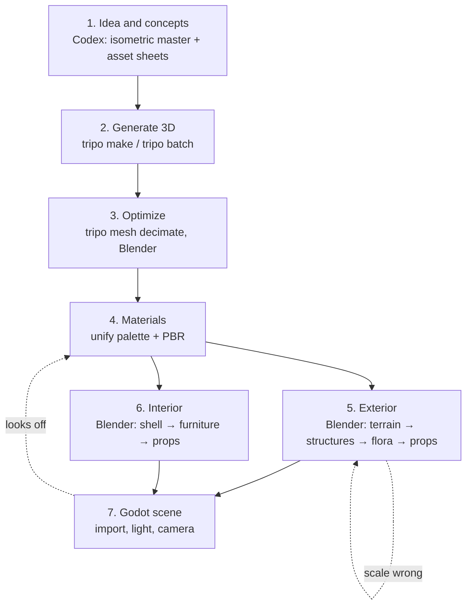
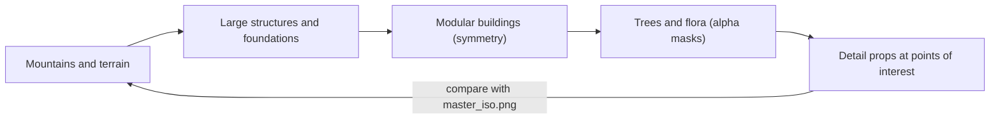

# Creating the xianxia world: 3D environment pipeline

How to take a rough idea of a xianxia location to a finished, lit environment in **Godot 4**, using **Codex CLI** for 2D references and **Tripo CLI** for 3D assets, with **Blender** for cleanup and assembly.

This guide adapts a seven-lesson environment curriculum (each lesson opens with a short summary of the matching lesson). The curriculum targets ChatGPT, Nano Banana, Tripo's web app, and Unreal Engine 5. Here every generation step runs from the terminal, and the last lesson targets Godot.

> AI agents: read [`AGENTS.md`](../AGENTS.md) first. Its hard rules (dry-run before spending credits, inspect every result, stay on theme, one scale) apply to every command below.

## Contents

- [Pipeline at a glance](#pipeline-at-a-glance)
- [Setup](#setup)
- [World brief: Azure Cloud Sect](#world-brief-azure-cloud-sect)
- [Lesson 1: Idea and concepts](#lesson-1-idea-and-concepts)
- [Lesson 2: Generation of 3D models](#lesson-2-generation-of-3d-models)
- [Lesson 3: Optimization and refinement](#lesson-3-optimization-and-refinement)
- [Lesson 4: Working with materials](#lesson-4-working-with-materials)
- [Lesson 5: Building up the scene (exterior)](#lesson-5-building-up-the-scene-exterior)
- [Lesson 6: Building up the scene (interior)](#lesson-6-building-up-the-scene-interior)
- [Lesson 7: Export and scene setup in Godot](#lesson-7-export-and-scene-setup-in-godot)
- [Troubleshooting](#troubleshooting)

## Pipeline at a glance



The central idea of the whole pipeline is **big to small**. Fix the large shapes first (mountains, terrain, big buildings). If the scale or silhouette is wrong, props and textures will not rescue it.

## Setup

```bash
npm install -g tripo-cli          # tripo --version → 0.7.x
tripo login --region ov           # or --region cn. Opens a browser approval, no key is pasted
tripo doctor
codex --version
godot --version                   # Godot 4.4 or newer
blender --version                 # Blender 4.x
```

Working folders for a zone (replace `gate_plaza` with the zone name):

```bash
mkdir -p art/concepts/world art/tripo-out/world game/assets/environment/gate_plaza game/scenes/environment
```

## World brief: Azure Cloud Sect

A placeholder location that every example in this guide uses. Replace it with your own idea. Keep the structure.

| Zone | What the player sees | Type |
| --- | --- | --- |
| **Cloud Gate Plaza** | Floating peaks behind a paifang gate, a wide white stone stair, stone lanterns, pines | Exterior |
| **Main Hall Terrace** | Vermilion multi-tier hall on a stone platform, bronze incense cauldron | Exterior |
| **Peach Blossom Garden** | Pond, arched bridge, blossom trees, bamboo | Exterior |
| **Sky Bridge** | Hanging chain bridge between floating islands over a sea of clouds | Exterior |
| **Alchemy Pavilion** | Round furnace room, shelves of jars, jade fixtures | Interior |
| **Scripture Library** | Tall shelves, paper screens, reading desks | Interior |

Use this style suffix on every prompt:

```text
xianxia fantasy, ancient Chinese immortal cultivation world, stylized realistic, soft painterly PBR textures, jade and celadon palette, misty atmosphere
```

---

## Lesson 1: Idea and concepts

> **Curriculum summary.** Turn a rough idea into a visual plan for the whole location, from a hand-drawn sketch or a text prompt. Generate an isometric master reference showing every zone, then break it down into detailed references for individual assets. Use the reference quality checklist and the batching trick to save tokens.

**Goal:** an isometric location reference plus a full set of asset references, ready for 3D generation.
**Tools:** Codex CLI (image generation).

### Steps

1. **Start from a rough idea.** Either a hand-drawn sketch (a photo of the paper) or a text prompt. Put it in `art/concepts/world/sketch.png` if you have one.
2. **Generate the isometric master reference.** One image showing **every zone**, seen from above at an isometric angle. This is the contract for the whole environment:

   ```bash
   codex exec -s workspace-write \
     "Generate an isometric master reference of a xianxia sect on floating mountains: a cloud gate plaza with a \
   paifang gate and white stone stair, a vermilion multi-tier main hall on a terrace, a peach blossom garden \
   with a pond and arched bridge, a chain sky bridge to a second floating island, and a sea of clouds below. \
   Stylized realistic, soft painterly PBR look, jade and celadon palette, misty atmosphere, clear readable \
   shapes, no characters. Save it as art/concepts/world/master_iso.png and confirm the file exists."
   ```

   With a sketch, attach it so the layout is respected: `codex exec -s workspace-write -i art/concepts/world/sketch.png "…"`.
3. **Break the master down into asset references.** For every asset in the master, ask for a clean reference: one object, neutral background, three-quarter view, no cast shadow. Group similar assets (see the batching trick).
4. **List the assets.** Write `art/concepts/world/asset_list.md` with one line per asset (`name, zone, size in metres, hero or filler`). It becomes the manifest in Lesson 2.

### Reference quality checklist

- [ ] One object per reference (or one clear sheet of objects).
- [ ] Neutral background, even lighting, no strong shadows.
- [ ] Three-quarter view, whole object visible and uncropped.
- [ ] Style matches the master (same palette, same level of detail).
- [ ] No text, logos, or characters.
- [ ] Looks like **xianxia**, not generic fantasy or modern Asia.

### Batching trick to save tokens

Generate **one sheet with 6–9 assets** (for example nine stone lanterns, tree variants, and railings) in a single request, then crop each object out in an image editor or with `magick`. One generation replaces nine, and the objects share a consistent style.

**You walk away with:** `master_iso.png`, one reference per asset or sheet, and `asset_list.md`.

---

## Lesson 2: Generation of 3D models

> **Curriculum summary.** Turn the references into 3D assets with AI: generate low-poly-first models and find the balance between detail and polygon count. Build simple modular elements by hand and texture them with AI when the generator cannot deliver clean results. Know when to generate with textures directly and when to go high-poly first and bake down.

**Goal:** a library of generated and hand-built 3D assets, ready for optimization and texturing.
**Tools:** `tripo make`, `tripo batch`, Blender.

### Low-poly first

Generate with a **low polygon budget** and add detail only where the camera goes. It is much easier to add detail later than to remove it.

1. **Check the plan of one hero asset for free:**

   ```bash
   tripo make "multi-tier xianxia pagoda with vermilion pillars, upswept eaves, glazed green roof tiles, white stone base, xianxia fantasy, stylized realistic, soft painterly PBR textures, jade and celadon palette" --for game-pc --name pagoda-main --dry-run --json --yes
   ```

2. **Generate it from its reference image** (the closest match to the concept):

   ```bash
   tripo make art/concepts/world/pagoda_main.png --for game-pc --name pagoda-main \
     -o art/tripo-out/world --json --yes
   ```

3. **Generate bulk filler with low-poly presets:**

   ```bash
   tripo make "stone garden lantern with carved lotus base, xianxia fantasy, stylized realistic, jade and celadon palette" --for game-mobile --name lantern-stone --dry-run --json --yes
   ```

4. **Batch the whole list.** Put the jobs in a manifest, check the plan of every job, then run it (resumable: finished jobs are skipped when you re-run):

   ```bash
   python3 scripts/check_docs.py        # dry-runs every text job in art/manifests/*.yaml
   tripo balance                        # confirm you can afford the batch
   tripo batch run art/manifests/environment-assets.yaml --concurrency 2
   ```

   The sample manifest is [`art/manifests/environment-assets.yaml`](../art/manifests/environment-assets.yaml).

### When Tripo cannot give clean results

Sometimes the generator cannot make clean structure (long straight walls, repeating railings, modular floor tiles). Build those **by hand** in Blender as simple modular elements: box walls, a 2 m floor tile, a 1 m railing section, a stair step. Then **paint them with AI**:

```bash
tripo model texture art/blender/export/railing_white_stone.glb --texture-quality standard \
  --name railing-white-stone -o art/tripo-out/world --json --yes
```

### Textured now or high-poly first?

| Situation | Approach |
| --- | --- |
| Filler props, buildings seen from far away | Generate **with textures** directly (`--for game-mobile`) |
| Hero pieces the camera gets close to (main hall, gate) | Generate **high-poly** (`--for game-pc`), clean in Blender, then bake down in Lesson 3 |
| Simple modular parts | Build by hand, texture with `tripo model texture` |

### Checklist

- [ ] Every asset in `asset_list.md` has a generated or hand-built model.
- [ ] Each was judged on `preview.png` and re-rolled if it was weak.
- [ ] Modular pieces are built by hand, not generated.
- [ ] Raw models are in `art/tripo-out/world/`, none committed.

**You walk away with:** a library of generated and hand-built 3D assets.

---

## Lesson 3: Optimization and refinement

> **Curriculum summary.** Clean up generated assets for production: fix geometry issues, reduce polygon count where needed, and prepare meshes for proper material assignment. Bake high-poly detail onto low-poly versions to keep visual quality without the performance cost. Cut the total material count from 60-80 down to roughly 20.

**Goal:** a clean, optimized asset library with correct geometry and a reduced material count.
**Tools:** `tripo mesh decimate`, Blender.

### Steps

1. **Fix geometry issues** in Blender: remove floating fragments, fill holes, recalculate normals (`Shift+N`), delete interior faces that nobody will see, merge by distance.
2. **Reduce the polygon count where needed.** Decimate the heavy hero pieces and bake their detail to the low-poly:

   ```bash
   tripo make art/tripo-out/world/pagoda-main/model.glb --then decimate:15000 --name pagoda-main-low --dry-run --json --yes
   ```

   | Asset type | Triangle budget |
   | --- | --- |
   | Hero building (main hall, gate) | ≤ 20,000 |
   | Medium structure (pavilion, bridge) | 5,000 – 10,000 |
   | Prop (lantern, cauldron, jar) | 300 – 2,000 |
   | Foliage card or tree | 500 – 3,000 |
   | Modular piece (wall, railing) | 50 – 500 |

3. **Prepare the meshes for material assignment.** Name materials consistently (`env_stone_white`, `env_wood_vermilion`, `env_roof_tile_green`, `env_jade`, `env_bronze`, `env_foliage`, `env_paper`), and make each surface a clean material slot.
4. **Bake high-poly detail onto low-poly versions** when you kept a high-poly source: use Tripo's built-in bake (the default for `decimate`) or Blender's **Selected to Active** bake. See [Module 6 of the character guide](character-pipeline.md#module-6-texture-baking).
5. **Cut the material count.** Generated assets ship with a material per object, so a whole zone arrives with **60–80 materials**. Cut it to roughly **20**:
   - Merge materials with the same job (all white stone shares one).
   - Pack small props onto a shared atlas.
   - Reuse a trim sheet for architecture.

### Checklist

- [ ] No non-manifold geometry, floating pieces, or flipped normals.
- [ ] Every asset is inside its triangle budget.
- [ ] Material count for the zone is about 20.
- [ ] Naming is consistent (`snake_case`, `env_` prefix for materials).

**You walk away with:** a clean, optimized asset library with correct geometry and reduced material count.

---

## Lesson 4: Working with materials

> **Curriculum summary.** Make separately generated assets look like they belong in the same world: correct clashing colour palettes against the original references, set up proper PBR materials (roughness, metallic, normal), and unify the visual style across the library. Learn to fix the colour inconsistencies that AI generation always introduces.

**Goal:** separately generated assets that look like they belong in the same world.
**Tools:** `tripo model texture`, Blender.

AI generation always introduces colour inconsistency: the same stone comes out cream in one asset and grey in the next. Fixing that is this lesson.

### Steps

1. **Correct clashing palettes against your references.** Compare each asset with `master_iso.png` and the palette in [`AGENTS.md`](../AGENTS.md). Fix hue and saturation in Blender (Hue/Saturation node on the Base Color) so all stone matches, all roofs match, and all wood matches.
2. **Re-texture outliers** instead of correcting them endlessly:

   ```bash
   tripo model texture @pagoda-main-low --texture-quality detailed --texture-alignment original_image \
     --name pagoda-main-tex -o art/tripo-out/world --json --yes
   ```

3. **Set up proper PBR** for each shared material:

   | Material | Base Color | Roughness | Metallic |
   | --- | --- | --- | --- |
   | `env_stone_white` | `#F2EEE3` | 0.85 | 0 |
   | `env_wood_vermilion` | `#B8362E` | 0.6 | 0 |
   | `env_roof_tile_green` | `#5FA38A` | 0.35 | 0 |
   | `env_jade` | `#5FA38A` | 0.2 | 0 |
   | `env_bronze` | `#8C6A3B` | 0.4 | 1 |
   | `env_paper` | `#F4EAD2` | 0.9 | 0, add soft emission for lit screens |

   Roughness, Metallic, and Normal are linear (non-colour) maps. Base Color is sRGB.
4. **Unify the visual style across the library.** Place every asset next to every other asset in one Blender scene under the same HDRI. Anything that sticks out in colour, saturation, or surface detail needs another pass.

### Checklist

- [ ] All stone, wood, and roof tile read as the same material across assets.
- [ ] Base Color has no baked lighting.
- [ ] Roughness and Metallic values are physically sensible.
- [ ] A line-up of the whole library under one light looks like one world.

**You walk away with:** a visually consistent asset library with unified PBR materials, ready for scene assembly.

---

## Lesson 5: Building up the scene (exterior)

> **Curriculum summary.** Compose the outdoor environment from big to small: lay out mountain ranges and terrain first, then large structures and foundations, then modular buildings using symmetry workflows. Populate the scene with trees and flora using alpha masks, and add detail props at points of interest. Check against the original reference constantly. If the scale is wrong, fix the big shapes first.

**Goal:** a fully assembled exterior with terrain, structures, vegetation, and detail props in place.
**Tools:** Blender.

### Work big to small



1. **Mountains and terrain first.** Block out the karst peaks and floating islands with simple displaced meshes. Get the silhouette and height right before anything else. Put the sea-of-clouds plane far below.
2. **Large structures and foundations.** Place stone terraces, platforms, and the stair. Everything else builds on these.
3. **Modular buildings with symmetry.** Build one half of a gate or hall and mirror it (`Mirror` modifier, Clipping on). Reuse the same modular walls, eave pieces, and roof ends. Chinese timber architecture is symmetrical, so a symmetry workflow is both faster and more authentic.
4. **Trees and flora with alpha masks.** Use cards with alpha-masked leaves for pines, blossom, and bamboo, not dense geometry. Group several card planes per tree.
5. **Detail props at points of interest.** Lanterns beside the stair, an incense cauldron before the hall, stone lions at the gate, a bench in the garden. Cluster props around places the player will look.
6. **Check against the reference constantly.** Toggle `master_iso.png` as a Blender background image after every pass. **If the scale is wrong, fix the big shapes first.**

### Scale reference

| Item | Size |
| --- | --- |
| Heroine | 1.65 m |
| Door | 2.2 m high, 1.2 m wide |
| Stair step | 0.18 m high, 0.30 m deep |
| Pagoda tier | 3.5 – 4.5 m per storey |
| Paifang gate | 8 – 10 m high |
| Peach/pine tree | 6 – 12 m |

Import `heroine.glb` into your Blender scene as a scale reference and delete it before export.

### Checklist

- [ ] Silhouette from the main camera matches the master reference.
- [ ] Heroine looks right beside doors, steps, and railings.
- [ ] Buildings are built from reused modular pieces.
- [ ] Foliage uses alpha cards, not dense meshes.
- [ ] No floating assets. Everything sits on a foundation.

**You walk away with:** a fully assembled exterior environment with terrain, structures, vegetation, and detail elements in place.

---

## Lesson 6: Building up the scene (interior)

> **Curriculum summary.** Build the interior spaces with the same big-to-small logic: walls and floors first, then furniture and structural elements, then small props and decorative details. Handle interior-specific lighting and material behaviour in enclosed spaces, and learn the composition principles that make interiors feel lived-in and believable.

**Goal:** completed interior spaces, furnished, detailed, and visually consistent with the exterior.
**Tools:** Blender.

The same big-to-small logic applies inside closed spaces.

1. **Walls and floors first.** Closed shell: floor, walls, ceiling, and wooden beams. Use the same stone and timber materials as the exterior (`env_stone_white`, `env_wood_vermilion`).
2. **Furniture and structural elements.** Pillars, shelves, desks, screens, the alchemy furnace, and the main focal piece of the room.
3. **Small props and decorative details.** Jars, scrolls, brushes, incense burners, hanging lanterns, talismans. Cluster them and leave empty space, so the room reads as lived-in rather than cluttered.
4. **Lighting specific to interiors.** Warm lantern light (`OmniLight3D`, about 2700 K) against cool daylight from windows and doors. Plan windows and paper screens as the main light sources.
5. **Material behaviour in enclosed spaces.** Surfaces get no sky light and rely on bounce. Check that dark wood and stone do not become black, and raise roughness on polished stone that reflects the lanterns.

### Composition principles that make interiors believable

- Give each room **one focal point** and one clear walking path.
- Break symmetry with one or two asymmetric props.
- Layer scale: large furniture, medium objects, then small items.
- Add signs of use: an open scroll, a half-burnt incense stick, a cup on the desk.

### Checklist

- [ ] Interior materials match the exterior.
- [ ] Every room has a focal point and clear path.
- [ ] Lantern light looks warm, with believable falloff and contrast.
- [ ] Doorways and windows line up with the exterior model.

**You walk away with:** completed interior spaces integrated into the environment.

---

## Lesson 7: Export and scene setup in Godot

> **Curriculum summary.** Export the finished environment from Blender and bring it into the game engine: import meshes and textures, rebuild materials, organise the level, and configure lighting, cameras, and final presentation settings so the scene works correctly in real time. This is the full handoff from an assembled Blender scene to a polished environment.

**Goal:** the finished environment exported from Blender and set up in Godot, ready for final presentation.
**Tools:** Blender, Godot 4.4+.

> The curriculum finishes in Unreal Engine 5. This project finishes in **Godot**. The goals are the same: import meshes and textures, rebuild materials, organise the level, and configure lighting, cameras, and presentation so it works in real time.

### Export from Blender

1. Delete reference objects (heroine, backgrounds).
2. Group by zone. Export **one `.glb` per zone kit** and one per unique prop: `File → Export → glTF 2.0 (.glb)`, **Apply Modifiers** on, **+Y Up** on.
3. Convert Tripo-made props to engine-friendly glTF with the pivot at the base and real-world size:

   ```bash
   tripo model convert @pagoda-main-tex --format GLTF --pivot-to-center-bottom --auto-size \
     --name pagoda-main-final -o art/tripo-out/world --json --yes
   ```

4. Copy finals and provenance:

   ```bash
   cp art/tripo-out/world/pagoda-main-final/*.glb game/assets/environment/gate_plaza/pagoda_main.glb
   cp art/tripo-out/world/pagoda-main-final/task.json game/assets/environment/gate_plaza/pagoda_main.task.json
   ```

### Import and rebuild materials in Godot

1. Run `godot --headless --path game --import --quit`, then open the editor.
2. Double-click each `.glb` → **Advanced…** → **Materials → Extract** into `game/assets/environment/<zone>/materials/` so you can edit them as `.tres`.
3. Merge duplicates so the whole scene stays near 20 materials. For foliage set **Transparency → Alpha Scissor** with a threshold of about 0.5.
4. For collision, name nodes in Blender with the suffix `-colonly` (a collision-only mesh) or `-col` (mesh plus collision). Godot builds the shapes on import.

### Organise the level

Build `game/scenes/environment/gate_plaza.tscn` with this structure:

```text
GatePlaza (Node3D)
├── Terrain            # mountains, islands, platforms
├── Structures         # gate, hall, pavilions (instances of the .glb kits)
├── Vegetation         # MultiMeshInstance3D for trees, bamboo, flowers
├── Props              # lanterns, cauldrons, benches
├── Interiors          # one sub-scene per interior, each with a LightmapGI
├── Lighting           # sun, probes, fog volumes
│   ├── Sun            # DirectionalLight3D
│   ├── WorldEnvironment
│   ├── MistSea        # FogVolume, large, low density
│   └── ReflectionProbe
└── Cameras            # CameraAttributesPractical, one Camera3D per hero shot
```

Instance this scene in `game/scenes/main.tscn`.

### Lighting, cameras, and presentation

| Item | Setting |
| --- | --- |
| Sun | `DirectionalLight3D`, warm white, shadows on, `directional_shadow_mode` at 4 splits for large views |
| Sky and mood | `WorldEnvironment` with a procedural or panorama sky, **Fog** on (light colour `#D9EBE6`), **Glow** on, Tonemap `AgX` or `Filmic` |
| Mist sea | A `FogVolume` plane under the islands, low density, slowly scrolling noise for movement |
| Interiors | `LightmapGI` baked per interior, `OmniLight3D` lanterns, a `ReflectionProbe` per room |
| Far scenery | `VisibilityRange` on distant meshes, `OccluderInstance3D` in big halls |
| Camera | 35–50 mm feel (`fov` 40–55°), `CameraAttributesPractical` with a mild depth-of-field for presentation shots |
| Final capture | Run with Movie Maker mode: `godot --path game --write-movie out/gate_plaza.avi --fixed-fps 60`, or capture a PNG from the viewport for the PR |

### Verify

```bash
godot --headless --path game --import --quit      # imports with no errors
godot --headless --path game --quit-after 2       # main scene loads
python3 scripts/check_docs.py
```

### Checklist

- [ ] Every `.glb` and `.task.json` is committed under `game/assets/environment/<zone>/`.
- [ ] Materials are extracted and merged. The zone is near 20 materials.
- [ ] Heroine (1.65 m) is at a believable scale in the scene.
- [ ] Lighting reads as xianxia: bright, misty, jade and celadon, with sparing spirit glow.
- [ ] Interiors are baked and light-matched with the exterior.
- [ ] A screenshot of the final presentation camera is attached to the PR.

**You walk away with:** a complete environment exported and set up in Godot, ready for final presentation.

---

## Troubleshooting

| Symptom | Fix |
| --- | --- |
| Assets look like different games | Redo Lesson 4: unify palette, re-texture outliers against `master_iso.png` |
| Everything is the wrong size | Run `tripo model convert … --auto-size`, check Blender unit scale (1 unit = 1 m), re-measure against the heroine |
| Too many materials | Merge by function, pack props to an atlas, reuse a trim sheet (Lesson 3) |
| Scene is slow | Use `MultiMeshInstance3D` for repeated props, add `VisibilityRange`, decimate, add occluders |
| Interior is pitch black | Add a `LightmapGI` or a `ReflectionProbe`, raise ambient light, check that windows emit light |
| Foliage looks like cardboard | Alpha Scissor plus a leaf texture with soft colour variation, 2–3 crossed cards per tree |
| Batch stops halfway | Re-run the same `tripo batch run` command. Finished jobs are skipped |
| Exit code 4 | Out of credits. Run `tripo topup` |
